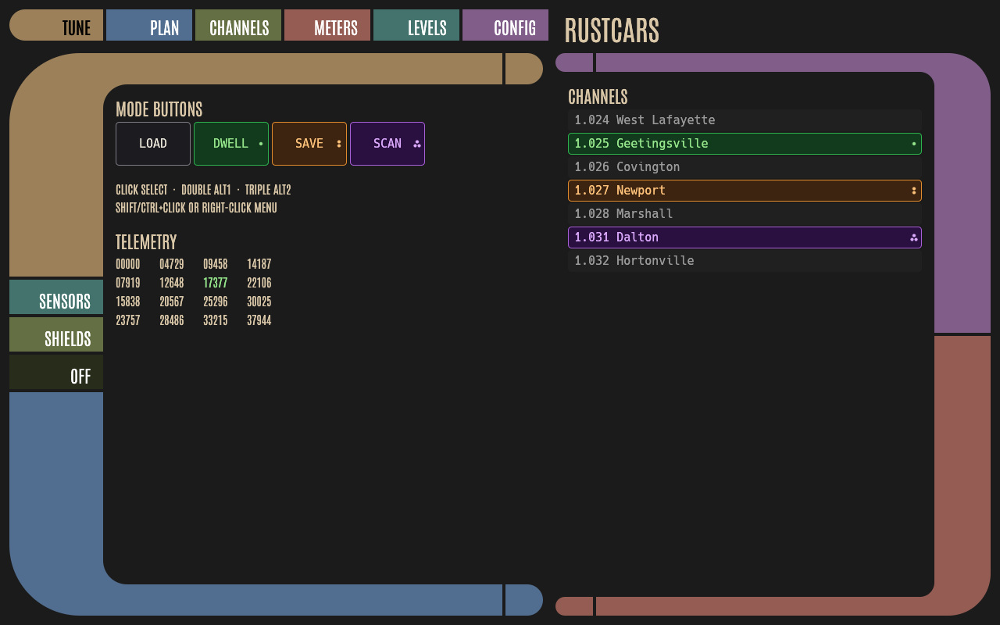
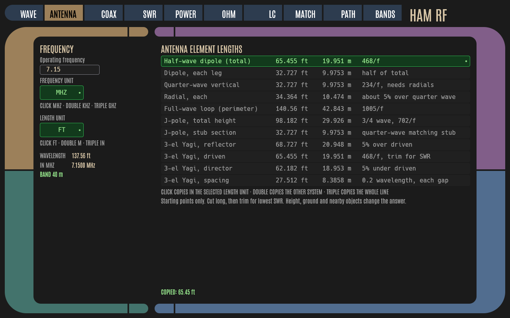
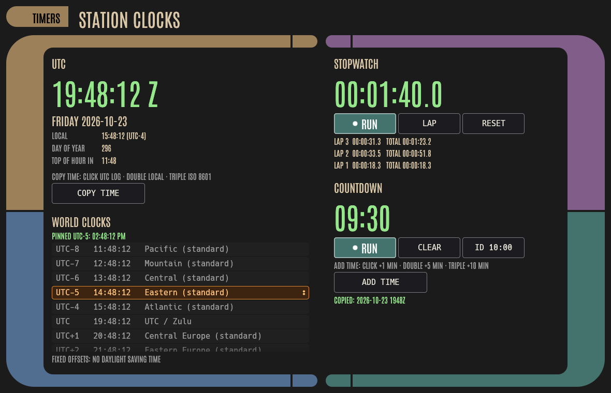
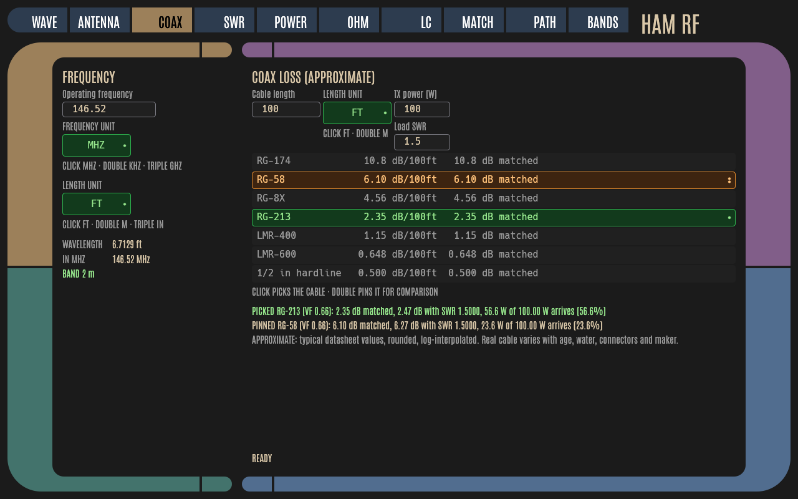
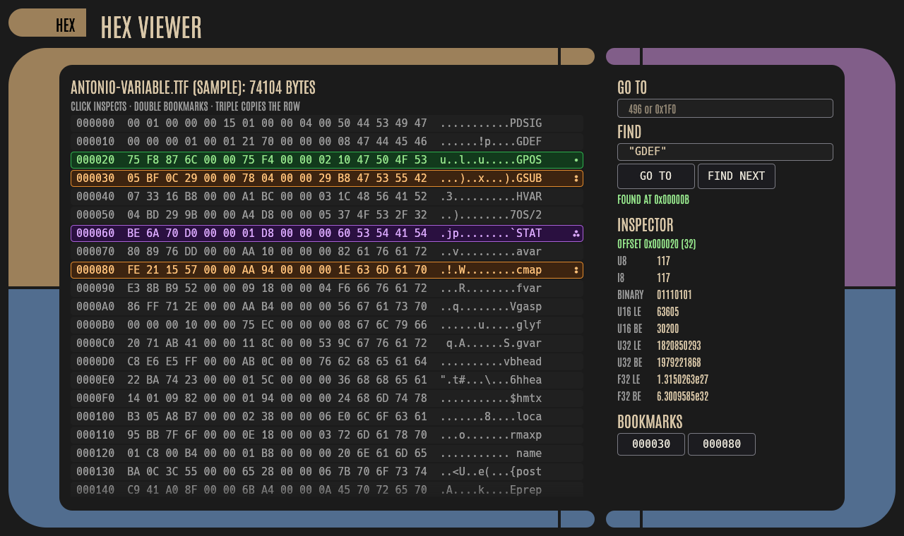
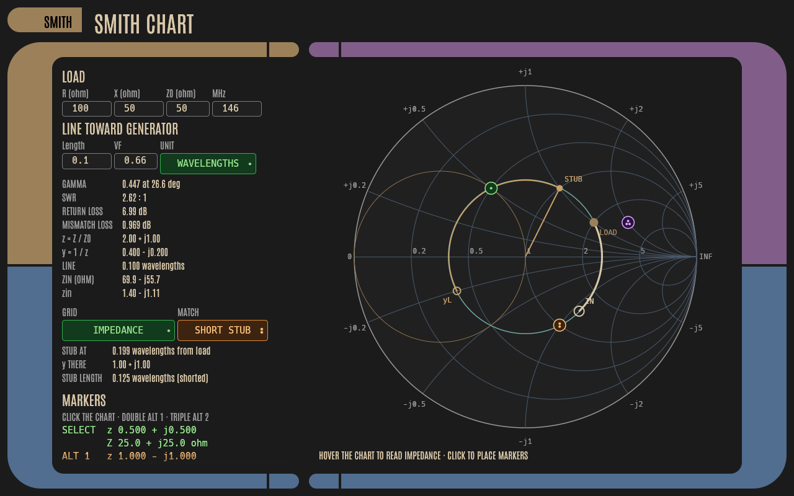
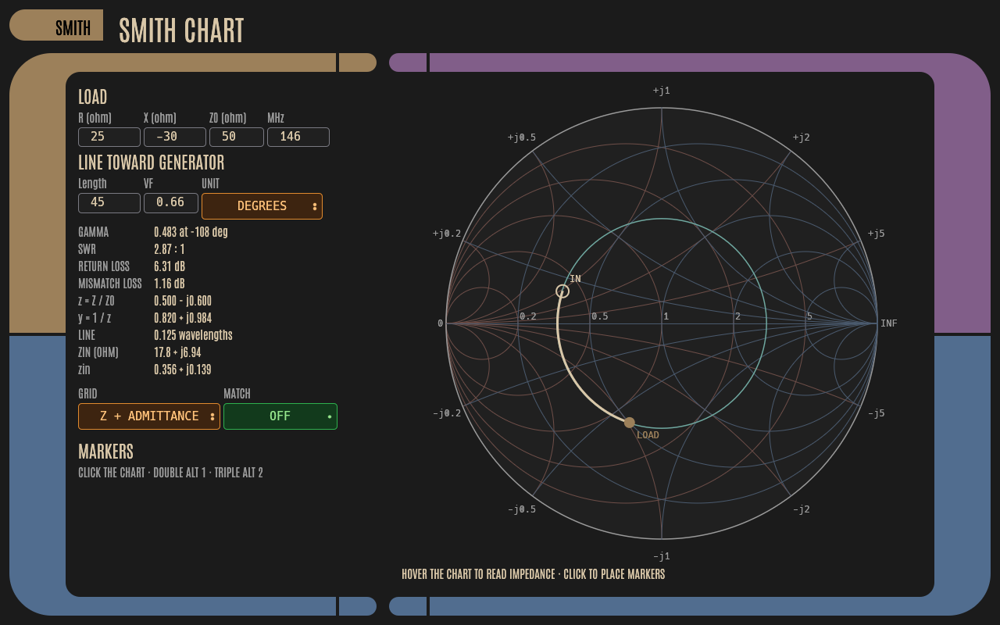

# rustcars

LCARS-style UI widgets and a demo for [egui](https://github.com/emilk/egui) 0.37 in Rust. Included:
- elbows for all four corners
- paint-behind frames that size themselves to their content
- pill buttons whose text color is chosen automatically for contrast
- data readouts
- a theme limited to the three font sizes and two spacing values the guideline calls for
- the Antonio font, bundled

Function buttons and list rows use click-count modes: click selects (green), double-click picks alternate 1 (orange), triple-click picks alternate 2 (purple). Each active mode also shows painted dots on the right of the control: · for 1, ∶ for 2, ⁖ for 3. Screen readers announce the mode name (e.g. "Scan, mode Alt 1"). The controls are drawn in a muted LCARS palette that meets WCAG 2.2 AA (see `AGENTS.md` §0).

The repo also contains [`AGENTS.md`](AGENTS.md), a set of design and implementation rules for coding agents building LCARS UIs with egui.



## Documentation

- **[Developer manual](docs/MANUAL.md):** 12 chapters covering principles, layout, controls, color, typography, feedback, accessibility, web, testing, example applications and a glossary. There is also a [PDF book edition](docs/rustcars-manual.pdf); rebuild it with `docs/build-manual.sh` (needs pandoc and typst).
- **[AGENTS.md](AGENTS.md):** rules for coding agents.
- **Examples:**
  - `cargo run --example minimal`: the smallest app.
  - `cargo run --example calculator`: scientific calculator with graphing. Function keys: click = function, double = inverse, triple = hyperbolic.
  - `cargo run --example diary [-- --db PATH]`: journal stored in SQLite, with search, edit and delete with undo.

  - `cargo run --example ham_rf`: ten ham radio calculators (wavelength, antenna lengths, coax loss, SWR, dB and power, Ohm's law, LC resonance, L-network matching, path loss, US band plan). The maths is in a unit-tested module. Click modes pick units, directions and band-edge targets.
  - `cargo run --example timers`: UTC and local clocks, world clocks, stopwatch with laps, countdown with a 10 minute ID timer, and a copy-time button (click = UTC log stamp, double = local, triple = ISO 8601).
  - `cargo run --example hexview [-- FILE]`: hex viewer with inspect, bookmark and copy as click modes, go to, and find.

  - `cargo run --example smith`: Smith chart with load, SWR circle, line rotation toward the generator, admittance overlay, hover read-out, click-mode markers and a single-stub match drawn on the chart.

  The examples are desktop only.

  | Calculator | Diary |
  |---|---|
  |  |  |

  | Ham RF | Timers |
  |---|---|
  |  |  |

  | Ham RF: coax | Hex viewer |
  |---|---|
  |  |  |

  | Smith chart | Smith chart: admittance grid |
  |---|---|
  |  |  |

  More ham RF screens: [SWR](docs/ham_rf_swr.png), [band plan](docs/ham_rf_bands.png).

## Run

```sh
cargo run            # opens the demo window (eframe)
```

## Test / re-render the preview

`tests/preview.rs` renders the demo headlessly with `egui_kittest` (wgpu). It writes `docs/preview.png` and compares the result against the snapshot in `tests/snapshots/lcars_demo.png`.

```sh
cargo test                       # renders + compares snapshot
UPDATE_SNAPSHOTS=1 cargo test    # accept a new snapshot
```

The test needs a Vulkan or GL device. On a machine without a GPU, install Mesa's software driver (lavapipe), e.g. `sudo apt install mesa-vulkan-drivers libvulkan1` on Debian/Ubuntu.

```sh
cargo clippy --all-targets -- -D warnings
```

## Web interface (optional, off by default)

The default `cargo build` produces only the desktop app and pulls in no web dependencies. Two separate opt-in features add web support.

| Feature | What it adds | Build / run |
|---|---|---|
| `web` | The same UI compiled to WebAssembly (eframe `WebRunner`, `src/web.rs`, `index.html`, `Trunk.toml`) | `rustup target add wasm32-unknown-unknown`, install [trunk](https://trunkrs.dev), then `trunk build --release` (outputs `dist/`) or `trunk serve` (http://127.0.0.1:8080). `index.html` turns on `--features web` itself. |
| `web-server` | `rustcars-web` binary: serves `dist/` plus a WebSocket device-bridge stub at `/ws` | `cargo run --features web-server --bin rustcars-web -- --enable [--bind 127.0.0.1:8080] [--dist dist]` |

How the pieces fit:
- **The browser can't reach your devices.** The wasm UI runs in the visitor's browser, so it can't touch the server's USB devices or GQRX's TCP port. Device access belongs only in the server process, behind the `DeviceBackend` trait in `src/bin/rustcars-web.rs`. The only backend today is `EchoBackend` (`ping` → `pong`, everything else echoed). It does no device access.
- **Off at runtime too.** `rustcars-web` refuses to start without `--enable`. It binds `127.0.0.1:8080` by default; pass `--bind 0.0.0.0:8080` to expose it on your LAN.

**Security:** there is **no authentication**, and the server prints a warning saying so at startup. Keep it on localhost, or put it behind an authenticating reverse proxy, TLS, or a VPN before exposing it.

**GitHub Pages:** the static `dist/` can be hosted on Pages, but Pages for a private repository requires a paid GitHub plan. A static site has no server bridge, so it is UI-only.

## Checks

`scripts/check.sh` runs:
- `cargo fmt --check`
- clippy for the desktop, wasm (`--features web --target wasm32-unknown-unknown`) and `--features web-server` builds
- all tests
- a check that the default build pulls no web dependencies

## Usage

```rust
let t = rustcars::LcarsTheme::default();
rustcars::install_lcars_font(ctx);
rustcars::apply_theme(ctx, &t);
// inside a Ui:
rustcars::LcarsFrame::new(&t, rustcars::Side::Left, 1.0).show(ui, &t, |ui| {
    rustcars::lcars_button(ui, &t, "Engage", t.primary, egui::vec2(150.0, 44.0), rustcars::Cap::Both, true);
});
```

## Credits

- **Design guidance:** "LCARS GuideLine" and "The LCARS Manifesto" by Bracer Jack (originally bracercom.com), republished by [lcars-terminal.de](http://www.lcars-terminal.de/tutorial/guideline.htm). `AGENTS.md` summarizes them with attribution.
- **Paint-behind elbow technique:** inspired by [paxel/dedup-rs](https://github.com/paxel/dedup-rs) (MIT). The code here is original.
- **Font:** [Antonio](https://github.com/googlefonts/antonioFont) by Vernon Adams, © 2013 The Antonio Project Authors, SIL Open Font License 1.1. See `assets/fonts/OFL.txt` and `assets/fonts/FONTS.md`.

## Disclaimer

Star Trek and LCARS are trademarks and/or copyrights of their respective owners (Paramount/CBS). LCARS was designed by Michael Okuda. This is an unofficial fan project and is not affiliated with or endorsed by those owners.

## License

The code is under the MIT License (see [LICENSE](LICENSE)). The bundled font is under the OFL 1.1.
