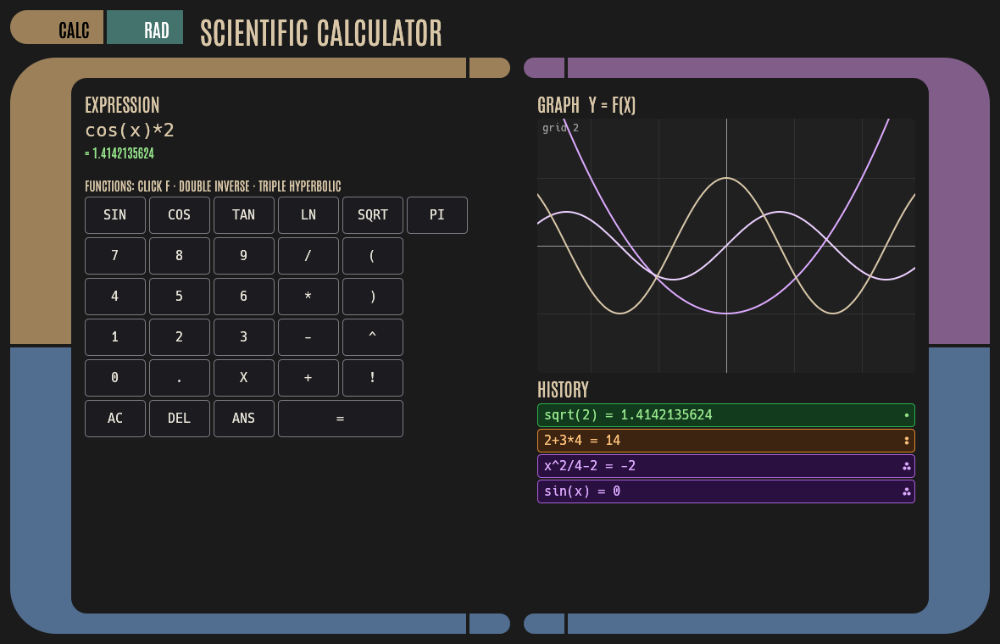
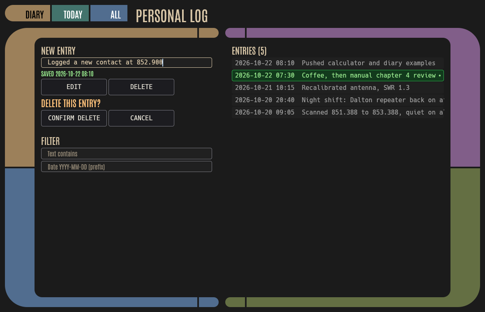

# 11. Example Applications

Two complete desktop applications show the rules in practice. Both are built only from rustcars widgets and the theme.

## 11.1 Scientific calculator

`cargo run --example calculator`. The source is in `examples/calculator/`: `main.rs` holds the UI and `eval.rs` the expression evaluator.



- **Function keys** are momentary `mode_button`s. The gesture picks the *variant* of one function:

  | Key | Click (·) | Double (∶) | Triple (⁖) |
  |---|---|---|---|
  | SIN, COS, TAN | sin | asin (inverse) | sinh (hyperbolic) |
  | LN | ln | exp (inverse) | log10 |
  | SQRT | sqrt | ^2 (inverse) | cbrt |
  | PI | π | e | ans |

  Shift and Ctrl work as Alt 1 and Alt 2, and right-clicking a key lists every variant by name.
- **Digits and operators** use `action_button`, which has no modes, so fast typing never merges into a double click.
- **History rows** (`mode_list`):
  - click inserts the result;
  - double-click loads the expression for editing;
  - triple-click plots it. The row stays purple while plotted; a triple click on it removes the plot.
- **Graph:** painted with egui's painter: a grid with a "nice" step, axes, drag to pan, scroll to zoom. Plotted functions use tints of the Alt 2 purple, all at least 4.39:1 against the plot background. Any input containing `x` is previewed live in the text color.
- **Keyboard:** typing goes straight into the expression; Enter evaluates, Backspace deletes, Escape clears.
- **DEG/RAD** is a navigation segment that toggles the angle unit.
- **Evaluator:** a small recursive-descent parser with precedence, right-associative `^`, factorial, implicit multiplication (`2x`), `pi`, `e`, `ans` and `x`. It has unit tests in `eval.rs`.

## 11.2 Diary

`cargo run --example diary [-- --db PATH]`. The source is in `examples/diary/`: `main.rs` holds the UI and `store.rs` the SQLite storage.



- **One focused field.** The NEW ENTRY field takes focus whenever no other widget has it, so you can always just type. Enter saves the entry with the current time.
- **Timestamps** are stored as UTC ISO-8601 (`2026-10-22T12:10:00Z`) and shown in local time.
- **Entry rows** use click modes, and only one row is active at a time:
  - click selects the row and shows Edit and Delete buttons;
  - double-click edits the entry in place;
  - triple-click quotes it into a new entry.
- **Forgiveness:** Delete asks for confirmation, and the last delete can be undone with *Undo delete*, which restores the original id and timestamp.
- **Filtering:**
  - text: a case-insensitive substring match where `%` and `_` count as literal characters;
  - date: a local `YYYY-MM-DD` prefix, so `2026-10` matches a whole month;
  - the *Today* and *All* segments are shortcuts.
- **Storage:**
  - `rusqlite` with the `bundled` feature (a dev-dependency, so library users never pull it in);
  - schema migrations tracked with `PRAGMA user_version`;
  - the database lives in the platform data directory via `directories::ProjectDirs` unless `--db` is given.
- **Tests:** in-memory database tests cover migration, filtering, editing, delete with undo, timestamps, and reopening a file.

## 11.3 Screenshots

Each example contains a kittest test that renders it headlessly:

```sh
cargo test --example calculator   # writes docs/calculator.png
cargo test --example diary        # writes docs/diary.png
```
